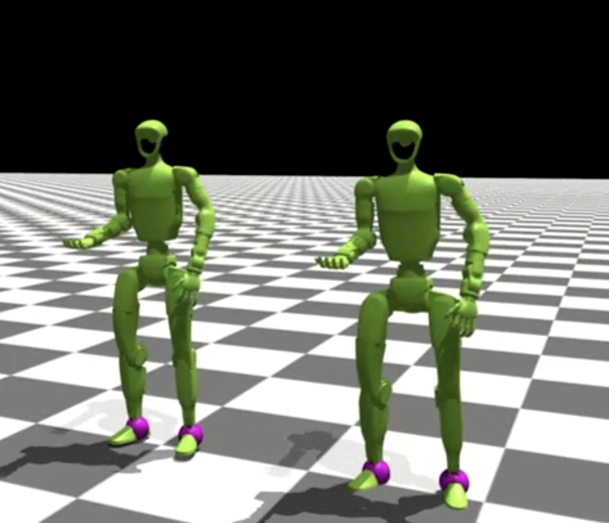

Developer Tips
==============

Quality of life tips for working with ProtoMotions.

Testing Simulator Setup
-----------------------

Use ``random_pose_visualizer.py`` to verify a robot loads correctly:

.. code-block:: bash

   python examples/random_pose_visualizer.py \
       --robot g1 \
       --simulator isaacgym

This sets random joint poses with **zero gravity and zero torque**. 
The robot should be able to hold its reset pose (press R key to reset).

This is the first thing to test when adding a new robot or a new simulator backend.

Comparing Motion Libraries
--------------------------

Use ``motion_libs_visualizer.py`` to compare ground truth vs learned motions:

.. code-block:: bash

   python examples/motion_libs_visualizer.py \
       --motion_files gt_motions.pt predicted_motions.pt \
       --robot g1 \
       --simulator isaacgym

**Features:**

* Side-by-side playback
* Yellow markers highlight jittery body parts (high normalized jerk)
* Purple markers highlight contact points with the ground
* Smoothness metrics (normalized jerk, oscillation index)
* Adjustable playback speed

**Saving predicted motions:**

Run inference in full-eval mode to save the predicted motion library:

.. code-block:: bash

   python protomotions/inference_agent.py \
       --checkpoint results/my_exp/last.ckpt \
       --simulator isaacgym \
       --full-eval \
       --headless \
       --num-envs 1024

Understanding Prioritized Sampling
----------------------------------

Motion imitation can sample difficult motions more often. The evaluator drives
the weights; nothing in the training loop guesses difficulty from rewards.

**How it works:**

1. Every ``eval_metrics_every`` epochs the training loop calls
   ``evaluator.evaluate()``. ``MimicEvaluator`` sweeps the motion library and
   returns an ``EvaluationResult`` with logs, an optional score, the evaluated
   count and per-motion ``failed`` / ``evaluated`` masks, after the environment
   and model state have been restored.
2. The training loop then calls ``evaluator.update_training_state(result)``.
3. ``MimicEvaluator`` updates only evaluated motions. It multiplies successful
   motions' weights by ``success_discount ** eval_metrics_every`` and divides
   failed motions' weights by ``failure_discount ** eval_metrics_every``.
   A zero failure discount instead resets failed weights to 1. Updated weights
   are clamped to ``min_motion_weight``. These settings live in
   ``motion_weights_rules``; the discount fields are named
   ``motion_weights_update_success_discount`` and
   ``motion_weights_update_failure_discount``. Weight updates need at least one
   ``failure_components`` entry.
4. ``inference_agent.py --full-eval`` calls ``evaluate()`` only, so offline
   evaluation never changes sampling weights.

See :doc:`evaluation` for configuring metrics and failure rules.

**What to monitor:**

Evaluation metrics are unweighted: each evaluated motion counts once.

* ``eval/{name}/mean``, ``eval/{name}/min`` and ``eval/{name}/max`` for every
  configured ``metric_components`` entry (``eval/gt_error/mean`` in the
  evaluation guide's example).
* ``eval/{name}/failure_rate`` for every ``failure_components`` entry and
  ``eval/success_rate`` overall.

Training rewards are collected under the current sampling weights, so a change
in a training reward curve after an evaluation can reflect the new motion mix
rather than a change in policy quality. Compare evaluation metrics instead.

Train Agent Modes
-----------------

``--training-max-iterations N`` sets the absolute number of rollout and
optimization iterations for the experiment. Each iteration collects one
``num_steps`` rollout from every environment and performs the configured
optimization updates. If an experiment is resumed at iteration 20 with a limit
of 100, training continues to iteration 100; it does not run 100 additional
iterations.

``train_agent.py`` has three modes:

**1. Fresh Start:**

New experiment name → build configs from experiment file

.. code-block:: bash

   python protomotions/train_agent.py \
       --experiment-name new_experiment \
       ...

**2. Resume:**

Same experiment name with existing checkpoint → load exact saved configs

.. code-block:: bash

   # First run
   python protomotions/train_agent.py --experiment-name my_exp ...
   
   # Resume (uses saved configs, ignores CLI overrides!)
   python protomotions/train_agent.py --experiment-name my_exp ...

.. warning::

   CLI overrides (``--overrides``) are **ignored** during resume. The system
   uses exactly the saved configs from the first run.

**3. Warm Start:**

``--checkpoint`` with new experiment name → old weights, new configs

.. code-block:: bash

   python protomotions/train_agent.py \
       --experiment-name new_exp_with_changes \
       --checkpoint results/old_exp/last.ckpt \
       ...

Create Config Only Mode
-----------------------

Generate configs without training:

.. code-block:: bash

   python protomotions/train_agent.py \
       --experiment-name migration_test \
       ... \
       --create-config-only

Useful for:

* Migrating old checkpoints when config APIs change
* Verifying configs before long training runs
* Debugging config composition

Kinematic Playback for Debugging
--------------------------------

Test motion + scene alignment without physics:

.. code-block:: bash

   python examples/env_kinematic_playback.py \
       --experiment-path examples/experiments/mimic/mlp.py \
       --motion-file my_motions.pt \
       --robot-name g1 \
       --simulator isaacgym \
       --scenes-file my_scenes.pt

This plays motions kinematically (sets poses directly, no simulation). Use to verify:

* Motion data is correct
* Scene objects are positioned correctly
* Retargeting didn't break anything
